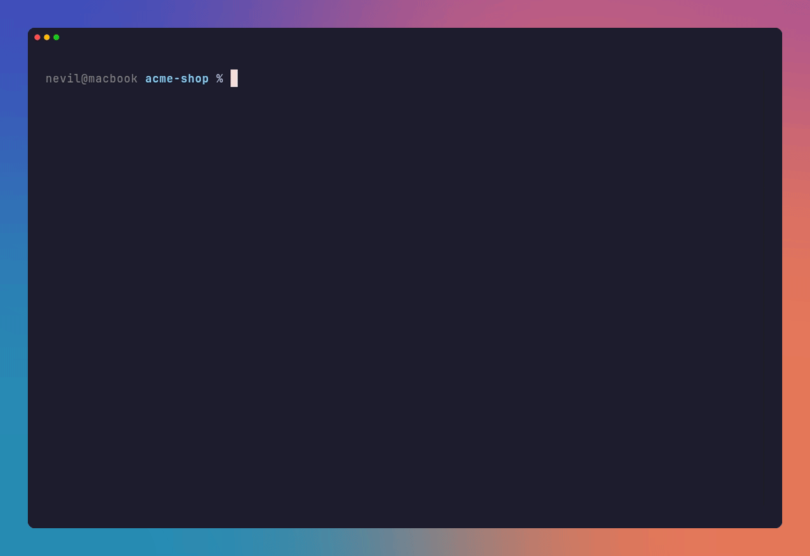
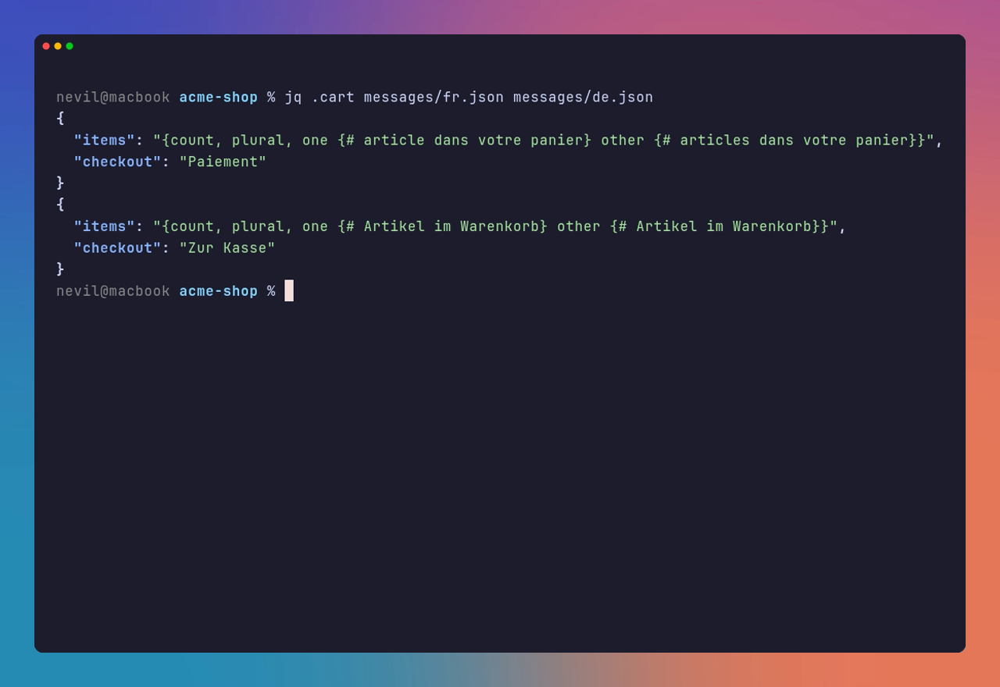
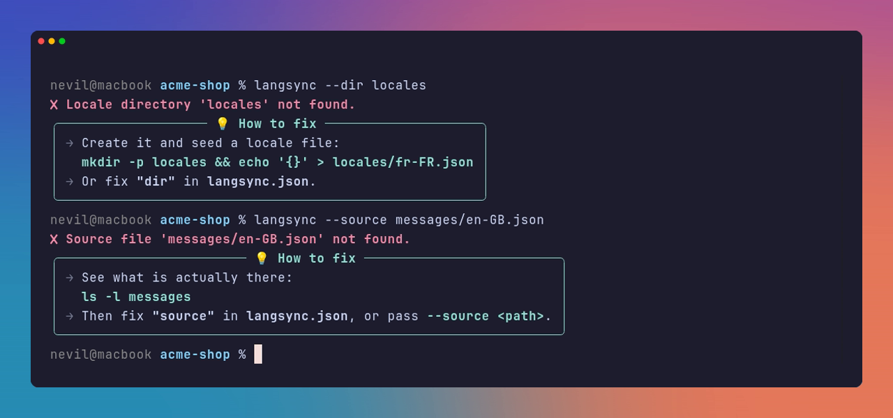
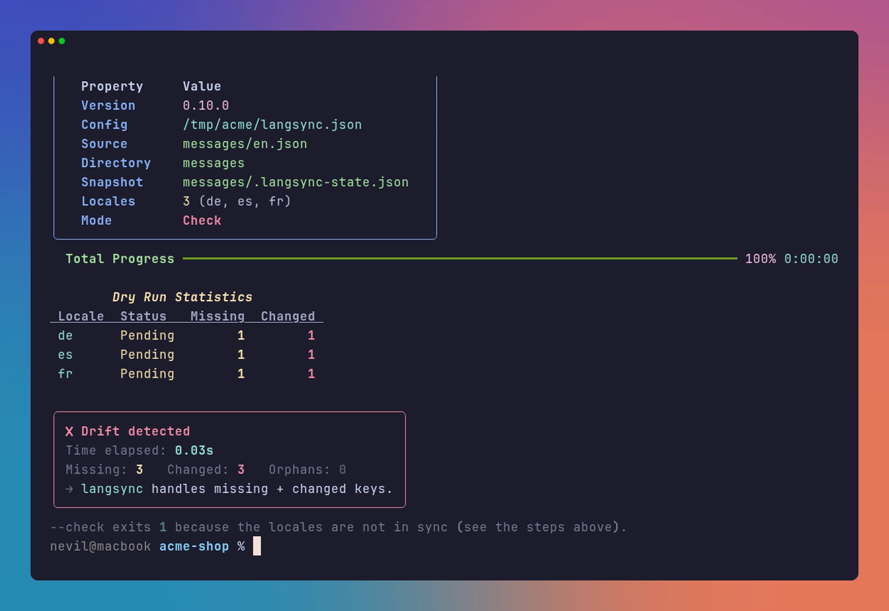

<p align="center">
  
</p>

<h1 align="center">LangSync</h1>

<p align="center">One source file, every language in sync. A CLI that fills missing translation keys,<br>re-translates edited ones and keeps ICU plurals valid, for any JSON i18n project.</p>

<p align="center">
  <a href="LICENSE"></a>
  <a href="pyproject.toml"></a>
  
  <a href="https://github.com/dracu-lah/langsync-cli/actions/workflows/ci.yml"></a>
</p>

<p align="center">
  <a href="https://langsync.pages.dev"></a>
  <a href="https://github.com/sponsors/dracu-lah"></a>
  <a href="https://buymeacoffee.com/nevil.dev"></a>
</p>

<p align="center">
  
</p>

## Install

```bash
curl -sSL langsync.nevil.dev | bash
```

The script installs with [pipx](https://pipx.pypa.io) and falls back to `pip --user`. Run the same
line again to update. To do it by hand:

```bash
pipx install git+https://github.com/dracu-lah/langsync-cli.git
```

## Quick start

Add a `langsync.json` to your project root, plus an empty `{}` file for each language you want:

```json
{ "source": "messages/en.json", "dir": "messages" }
```

```bash
echo '{}' > messages/fr.json
langsync
```

Every key in `en.json` now exists in `fr.json`, translated. Run it again after editing the source and
only the new and changed keys go out.

## What it does

- **Only what changed.** A snapshot of every source string tells new keys from edited ones.
  Translations you did not touch stay as they are.
- **ICU plurals stay valid.** Only the words inside `plural`, `select` and `selectordinal` branches
  are translated. Each rebuilt message is parsed before it is written, and a broken one is rejected.
- **Repairs broken strings.** A target with broken ICU, often left by an older tool, is re-translated
  in place on the next run.
- **Batched and parallel.** Keys go out in batches and locales run side by side, with backoff when
  the API rate limits.
- **Placeholders untouched.** `{name}`, `<b>tags</b>` and whitelisted brand names come back exactly
  as they went in. Arrays and nested objects are translated element by element.
- **Errors with the fix.** Every error and warning ends with the command that fixes it, ready to
  paste.

<p align="center">
  
  
</p>

## Usage

```bash
langsync                     # sync every locale file in "dir"
langsync --dry-run           # show what would change, write nothing
langsync -l fr-FR,de-DE      # only these locales
langsync --update-changed    # re-translate edited keys only, skip missing ones
langsync --rewrite           # re-translate everything (replaces existing translations)
langsync --prune             # remove keys the source no longer has
langsync --check             # exit 1 on drift, for CI
langsync -v                  # print every key as it is processed
```

### In CI

`--check` writes nothing and exits 1 when any locale has missing, changed or orphan keys, so a pull
request that edits `en.json` without syncing fails:

```yaml
- run: pipx install git+https://github.com/dracu-lah/langsync-cli.git
- run: langsync --check
```

<p align="center">
  
</p>

## Configuration

LangSync reads the first of `langsync.json`, `.langsync.json` or `~/.langsync.json`. Flags override it.

```json
{
  "source": "messages/en-GB.json",
  "dir": "messages",
  "max_parallel_locales": 5,
  "batch_size": 25,
  "whitelist": ["MyBrand", "ProMode"]
}
```

The snapshot lives in `<dir>/.langsync-state.json`. Commit it, so the next person's run knows which
keys you already translated. On a first run inside a git repository, LangSync builds it from history.

## Development

```bash
pipenv install
pipenv run pip install -e .
pipenv run pytest
```

[CONTRIBUTING.md](CONTRIBUTING.md) has the ground rules. The website lives in [site/](site) and
deploys to Cloudflare Pages.

## Support

- **Bugs and ideas:** [Issues](https://github.com/dracu-lah/langsync-cli/issues). Security reports
  follow [SECURITY.md](SECURITY.md).
- **Chip in:** LangSync is free and MIT licensed. If it saves you time,
  [sponsor it on GitHub](https://github.com/sponsors/dracu-lah) or
  [buy me a coffee](https://buymeacoffee.com/nevil.dev). A star helps the next person find it.

## License

[MIT](LICENSE) © dracu-lah. Translations go through Google Translate via
[deep-translator](https://github.com/nidhaloff/deep-translator).
